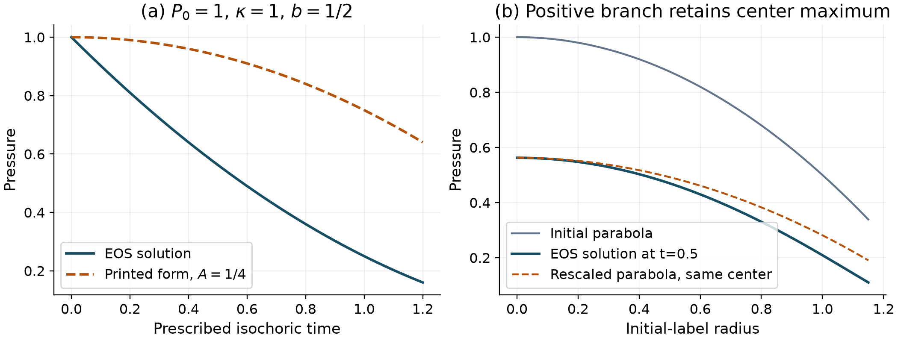
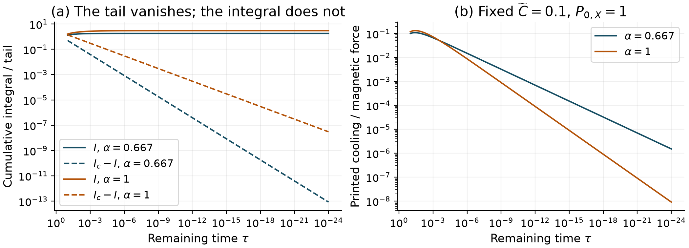
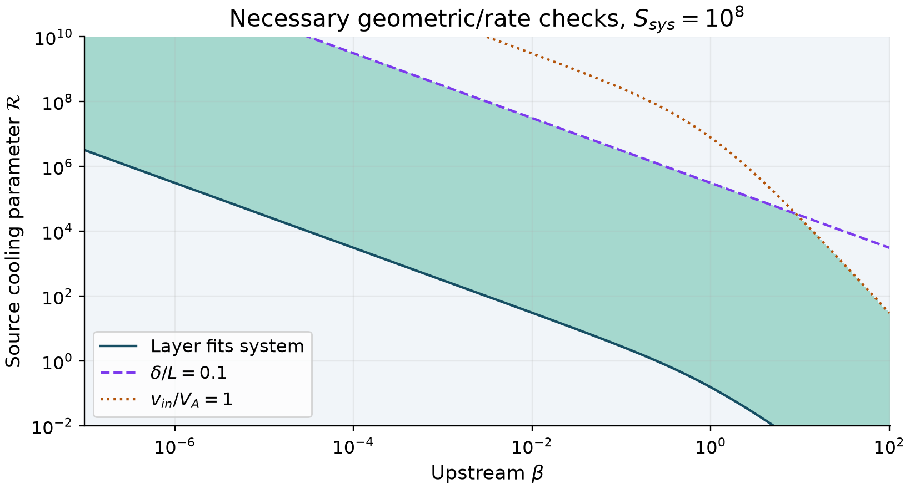

# Thermodynamic consistency and closure limits of radiatively cooled X-point collapse

**Taylor Kalin**

Independent researcher; https://taylorkalin.com

ORCID: 0009-0003-9000-9315; correspondence: teylersf@gmail.com

Version 1.1.1; 29 October 2026

## Abstract

We examine the thermodynamic reduction in Chowdhry and Loureiro's model of current-sheet formation under radiative cooling, using its journal and arXiv editions. The displayed pressure formula does not solve the stated energy equation. Direct integration gives a Bernoulli solution whose initial cooling rate is nonzero, whereas the published bremsstrahlung form has zero initial cooling rate for every finite spatial integration coefficient. Correcting this formula generally destroys the exact parabolic-pressure affine closure. On the common positive-pressure branch, the corrected scalar evolution preserves pressure ordering; in the published final ordinary differential equations, outflow deceleration while the inflow scale is shorter than the outflow scale requires negative central total pressure. Separately, a cumulative cooling integral cannot be replaced by its vanishing endpoint tail. At fixed finite coefficients and finite positive outflow scale, that integral makes the printed cooling-to-magnetic force ratio tend to zero, contradicting the proposed strict cooling-dominated endpoint balance under those hypotheses. We retain the algebra of the modified steady Sweet-Parker branch and state its parameter-domain and stability limitations. Direct scalar integrations and separate high-precision checks support these bounded conclusions. They do not reconstruct the original numerical trajectories or rule out physical radiative contraction in a different model.

## 1. Target and scope

Radiative cooling can change the pressure and compression of reconnecting layers. Chowdhry and Loureiro [1,2] propose an affine X-point-collapse model and a separate modification of a radiatively cooled Sweet-Parker layer. Their abstract connects strong cooling to accelerated inflow collapse and arrested or reversed outflow elongation. The pressure reduction is therefore central to the proposed dynamical explanation, rather than a peripheral normalization choice.

We examine the 26-page journal version of record, *Journal of Plasma Physics* **91**(6), E148 (2025), DOI 10.1017/S0022377825100949 [1], and the supplied 24-page arXiv:2508.13081v1 [2]. The supplied preprint is byte-identical to the official versioned PDF. Both editions have been read completely. The final article corrects the preprint's missing equality in Eq. (2.14), updates the flow-rate symbols in Eq. (3.1), and adds cooling-law, Newtonian-MHD and relativistic-applicability qualifications. Those improvements are credited. The pressure construction, principal collapse balances and steady-layer expressions addressed here remain in the final edition. Locators below refer to [1] unless stated otherwise. The 24-page count is the actual page-tree count of the versioned preprint (966,878 bytes, SHA-256 `49dd1f97967345a7c22825158758ab1ed49529abd27c717ee2bdbc6ef7c40c0c`); the journal PDF has 26 pages (786,255 bytes, SHA-256 `1e47de8f1bbdb554c26efe029b13127cdbf4464fe6599721b64129f86b22150e`). Byte identity is between the supplied preprint and official arXiv v1, not between preprint and journal. A secondary catalogue page count does not override the retrieved PDF page tree. On 29 October 2026, the official article, primary Crossref relation/update fields and targeted title/DOI correction searches revealed no identified target-specific erratum, corrigendum or response. An adjacent issue-list erratum was unrelated. This bounded negative search is not proof that none exists; no response from the source authors was obtained.

The main question is internal consistency: do the displayed reductions satisfy the energy equation and their own positivity and asymptotic assumptions? We derive the pressure evolution first, then examine its spatial implications. Separate checks preserve the steady-layer algebra instead of treating every conclusion as invalid. No original numerical analysis program or complete set of execution inputs was obtained from the inspected source archive. The original curves are not reproduced here.

## 2. The pressure initial-value problem

Let $J(t)=\xi(t)\eta(t)>0$ be the affine Jacobian, with the source's normalization $J(0)=1$, and $\rho_L=\rho_0/J$. We use $\bar C$ for the positive coefficient already defined by the source's Eq. (2.22), including its conversion factors. Equation (2.23) is

$$
\frac{d}{dt}\ln\left(\frac{P_L}{\rho_L^\gamma}\right)
=-\bar C\rho_L^{a-b}P_L^{b-1}. \tag{1}
$$

The derivative follows a fixed fluid label. Define

$$
Y=P_LJ^\gamma,\quad q=b(1-\gamma)+\gamma-a,\quad
\kappa=\bar C\rho_0^{a-b},\quad I(t)=\int_0^t J(t')^q\,dt'.
$$

Then Eq. (1) gives $\dot Y=-\kappa J^qY^b$, with $Y(0)=P_0$. On the positive branch its unique solution is

$$
P_L=J^{-\gamma}
\left[P_0^{1-b}-(1-b)\kappa I(t)\right]^{1/(1-b)},
\qquad b\ne1, \tag{2}
$$

and

$$
P_L=J^{-\gamma}P_0\exp[-\kappa I(t)],\qquad b=1. \tag{3}
$$

For $b<1$, Eq. (2) is used only while its bracket is positive. Continuing a squared bremsstrahlung expression beyond its zero would reverse the sign of the square root used in the derivation and cease to solve the same positive-pressure equation. These formulas require no special value of the initial pressure and no choice of an additional spatial integration function.

In contrast, after choosing $C_2=P_0$, the source's Eqs. (2.24)-(2.27) and (A5)-(A6) have the functional form

$$
Y_{\rm pub}=P_0\left[1-\widetilde C I(t)^{1/(1-b)}\right]. \tag{4}
$$

This expression puts the initial pressure outside the nonlinear power. It is not Eq. (2). The source also asserts that an independent spatial $C_2$ remains unconstrained after specifying the initial condition. A first-order scalar initial-value problem on $P_L>0$ has no such freedom. In Appendix A, the equality between $d\ln F/dt$ and $F^{-b}\dot F$ in Eq. (A4) already changes the left-hand side; adding homogeneous and particular solutions does not repair a nonlinear equation by superposition.

The bremsstrahlung case gives a normalization-independent counterexample. With $b=1/2$, Eq. (2) requires

$$
Y=\left(\sqrt{P_0}-\frac{\kappa I}{2}\right)^2,
\qquad \dot Y(0)=-\kappa\sqrt{P_0}\ne0. \tag{5}
$$

Every finite coefficient multiplying $I^2$ in Eq. (4) instead gives $\dot Y_{\rm pub}(0)=0$ for regular $J(0)>0$. Changing that finite coefficient cannot recover the missing derivative. For the elementary prescribed history $J=1$, $P_0=\kappa=1$, the correct pressure is $(1-t/2)^2$ until $t=2$; a printed-form example with $\widetilde C=1/4$ is $1-t^2/4$. At $t=1$ these give $1/4$ and $3/4$. The numerical coefficient in this illustration is declared, not inferred from an original plotted run.

Figure 1. Left: the isochoric bremsstrahlung solution has a nonzero initial cooling slope; the printed functional form does not. Right: at $t=0.5$, an initially parabolic profile remains centrally maximal but is not a common rescaling of that parabola. The dashed comparison is matched at the center.

The discrepancy is not universal across all exponents. At $b=0$, a specifically calibrated additive coefficient can reproduce Eq. (2); it is not arbitrary. At $b=1$, the exponential solution must be treated separately. These controls help distinguish the nonlinear integration error from a blanket rejection of every cooling law.

## 3. Spatial closure and the pressure sign

The source chooses spatially uniform initial density and
$P_0=P_{0,X}[1-(x_0^2+y_0^2)/2]$, then assumes a spatially uniform $J(t)$. For fixed common $J$, differentiating the repaired solution with respect to its positive initial value gives

$$
\frac{\partial P_L}{\partial P_0}
=J^{-\gamma}\left(\frac{Y}{P_0}\right)^b>0. \tag{6}
$$

Thus pressure ordering is preserved while both compared labels remain on the positive branch. The initially higher central pressure cannot fall below a lower surrounding pressure in this scalar, uniform-density affine construction. Different fractional cooling rates do not by themselves reverse the ordering. Once a label reaches the boundary of the assumed cooling law, this comparison makes no assertion about additional physics beyond it.

For $b=1/2$, the factor in Eq. (6) is
$J^{-\gamma}[1-\kappa I/(2\sqrt{P_0})]$. It depends on position through $P_0$. Multiplying the initial parabolic gradient by this factor generally produces a non-affine force. Consequently, inserting the correct pressure into momentum does not simply yield the source's two scale-factor equations with a repaired time-only cooling factor. Special cases such as $b=0$, $b=1$, uniform pressure or zero cooling must be separated. A local Taylor expansion about the origin could define an approximate closure, but that would be a new approximation requiring its own validation, not the claimed exact global reduction.

There is also a direct positivity restriction inside the source's *printed* final Eq. (2.31). For bremsstrahlung, write $\theta=1-\widetilde C I^2$ and $D=\xi^{-2}-\eta^{-2}$. Its outflow acceleration becomes

$$
\ddot\eta=\xi\left[D+\frac{P_{0,X}\theta}{(\xi\eta)^\gamma}\right]. \tag{7}
$$

If $0<\xi<\eta$, $P_{0,X}>0$ and $\theta\ge0$, every term on the right is nonnegative and $D>0$. Hence $\ddot\eta>0$. Deceleration on this branch requires $\theta<0$, which is negative central *total thermal pressure* in Eq. (2.26). Negative pressure is necessary here, not sufficient to outweigh the magnetic term. The pressure is not defined as a freely adjustable perturbation; adding a constant background changes an absolute-pressure nonlinear cooling law and requires solving that law again.

This restriction matters for the interpretation in Section 3.3, which invokes stronger nonuniform compression and a pressure maximum turning into a minimum. The stated affine Jacobian and uniform initial density instead give spatially uniform density at each time. Neither that proposed density mechanism nor a positive-pressure central minimum follows from the equations supplied. This does not prove that a nonuniform-density plasma, a non-affine flow or a more complete radiative-MHD model cannot contract along its outflow direction. Section 3 does not solve the repaired, generally non-affine momentum system. Its deceleration implication concerns only the printed ODE, and the scalar examples are not momentum solutions. The source uses the same pressure $P$ in its full energy equation (2.4), absolute radiated-power law and initial profile (2.25), reproduced below. No subtracted equilibrium pressure is introduced in this reduction. Thus the central value $P_{0,X}$ is a thermodynamic-pressure value; a reinterpretation as a signed perturbation would require an additional background term in the nonlinear cooling law.

## 4. Cumulative cooling and endpoint balances

A separate issue remains even if the published ODE is examined formally. For $a=2$, $b=1/2$, $\gamma=5/3$, Eq. (2.29) defines $I=\int_0^t(\xi\eta)^{-2/3}dt'$. Suppose $\tau=t_c-t$, $\eta\to\eta_c>0$ and $\xi\sim A\tau^\alpha$, with no earlier singularity. For the proposed $\alpha=2/3$ and $\alpha=1$, the endpoint is integrable:

$$
I_c-I(t)\sim
\frac{(A\eta_c)^{-2/3}}{1-2\alpha/3}\,
\tau^{1-2\alpha/3},\qquad 0<I_c<\infty. \tag{8}
$$

It is the tail $I_c-I$, rather than the integral from the initial time, that vanishes. The scaling substitution in Section 3.2 and Appendix B drops this positive cumulative constant. It is leading order, not a negligible integration term. In particular, the ratio of the printed radiative-force magnitude to its inverse-square magnetic term is

$$
\mathcal D= P_{0,X}\widetilde C I(t)^2
\eta^{-\gamma}\xi^{2-\gamma}
\sim \mathrm{const.}\,\tau^{\alpha/3}\longrightarrow0. \tag{9}
$$

This limit uses fixed finite coefficients and a finite positive $\eta_c$. It contradicts a strict endpoint balance dominated by that cooling term under those same hypotheses, including the proposed intermediate equality in Eq. (3.13). A large coefficient can delay the crossover greatly. The argument does not reject a finite-window effective exponent near one, a joint infinite-cooling limit, or a branch where $\eta$ also vanishes. It also does not determine the physical endpoint of the repaired, non-affine thermodynamic problem. Substituting exactly $\alpha=1$ into a second-derivative leading balance additionally requires care because $\alpha(\alpha-1)=0$.

Figure 2. For $t_c=1$, $\eta=1$, $\xi=\tau^\alpha$, the cumulative limit is $I_c=1/(1-2\alpha/3)$: $1.8$ or $3$. The force ratio uses fixed $P_{0,X}=1$ and $\widetilde C=0.1$. The printed pressure factor remains positive in both examples. The small remaining-time values illustrate an analytic limit; they are not measured physical collapse times.

The leading inverse-square scalar equation also fixes a coefficient:
$\ddot\xi=-\eta_c/\xi^2$ requires $A^3=9\eta_c/2$ for $\xi=A\tau^{2/3}$. Appendix B's Eq. (B14) instead prints $9\eta_c/4$, giving half the required acceleration. The missing factor is visible between its kinetic-energy first integral and quadrature. This is a discrepancy in the target's displayed calculation, not an allegation about the classical literature it cites.

A conditional local check can also retain the coupling to $\eta$. Consider a $C^2$ positive branch of the *printed* Eqs. (2.29) and (2.31), with fixed finite coefficients, no earlier singularity, $\xi\sim A\tau^{2/3}$ and $\eta\to\eta_c>0$. This assumes a branch if it exists; it does not establish one for the source initial data. Define $H(t)=P_{0,X}\eta(t)^{-2/3}(\widetilde C I(t)^2-1)$ and $H_c=\lim H(t)$. The exact printed equations become

$$
\begin{aligned}
\ddot\xi&=-\eta\xi^{-2}+\eta^{-1}-H(t)\xi^{-5/3},\\
\ddot\eta&=\xi^{-1}-\xi\eta^{-2}-H(t)\eta^{-1}\xi^{-2/3}.
\end{aligned}
$$

The second equation gives $\ddot\eta=O(\tau^{-2/3})$, hence $\dot\eta\to v_c$ and $\eta=\eta_c-v_c\tau+O(\tau^{4/3})$. The cumulative-integral tail in Eq. (8) then gives $H-H_c=O(\tau^{5/9})$. Thus the first equation is $\ddot\xi=-\eta_c\xi^{-2}-H_c\xi^{-5/3}+\mathcal R(t)$, where

$$
\mathcal R=-(\eta-\eta_c)\xi^{-2}-(H-H_c)\xi^{-5/3}+\eta^{-1}
=O(\tau^{-5/9}).
$$

This remainder is later than the nonzero limiting thermal force of order $\tau^{-10/9}$. More than formal differentiation of a leading equivalence is needed to obtain the correction. The exact scalar-energy identity

$$
\mathcal E=\frac{\dot\xi^2}{2}-\frac{\eta_c}{\xi}-\frac32H_c\xi^{-2/3},
\qquad\dot{\mathcal E}=\dot\xi\mathcal R=O(\tau^{-8/9})
$$

has an integrable right-hand side, because the first equation also implies $\dot\xi=O(\tau^{-1/3})$. Therefore $\mathcal E\to\mathcal E_c$ and the decreasing endpoint branch has $\dot\xi^2=2\eta_c/\xi+3H_c\xi^{-2/3}+2\mathcal E_c+O(\xi^{1/6})$. Integrating its inverse speed gives

$$
\tau=\frac{2\xi^{3/2}}{3\sqrt{2\eta_c}}
\left[1-\frac{27H_c}{44\eta_c}\xi^{1/3}+O(\xi^{2/3})\right].
$$

Inversion yields

$$
\begin{aligned}
\xi&=A\tau^{2/3}+D_1\tau^{8/9}+O(\tau^{10/9}),\\
A^3&=9\eta_c/2,\qquad D_1=\frac{81}{44}H_cA^{-5/3}.
\end{aligned}\tag{10}
$$

For $H_c\ne0$ this is the first correction on the stated branch. When $H_c=0$, a nonzero limiting scalar-energy constant instead gives a $\tau^{4/3}$ correction; further cancellations require further analysis. The bounds are not asserted uniformly in varying parameters. These local results concern the printed ODE, not repaired thermodynamics, physical collapse or a reconstruction of original curves. The archived scalar quadrature controls test frozen coefficients; they do not numerically evolve or validate this coupled local branch.

## 5. Normalization and the steady branch

Some local printed discrepancies can be identified without using the pressure solution. Using the approximate right-hand side printed in Eq. (2.33) and the outflow time in Eq. (2.34), with $D_0=\bar C\rho_0^{a-b}P_{0,X}^{b-1}$, their ratio is $R=D_0/\Gamma_{y,0}$. Equation (2.35) instead multiplies by $\Gamma_{y,0}$. A unit normalized initial rate masks the difference. The literal pressure-over-radiated-power definition would give $D_0/[(\gamma-1)\Gamma_{y,0}]$; either clock retains division by the outflow rate. Equation (2.36) also reverses $1-b$ to $b-1$ relative to Eq. (2.27); bremsstrahlung's squared exponent masks that sign. Neither discrepancy establishes which values an unavailable plotting implementation used. These clock-convention factors are distinct from the energy-equation failure.

The separate steady model deserves a positive control. Its continuity, Ohm's-law, power and cooling/advection balances give Eqs. (4.7)-(4.16), including $A\approx1+\beta$, consistently within their displayed approximations. Here $A=\rho_X/\rho_{\rm in}$ denotes compression, rather than the collapse amplitude, and $\beta=\beta_{\rm in}$. We retain these balances. With $c=(\gamma-1)/\gamma^{3/2}$, the bremsstrahlung branch is

$$
\lambda\equiv\frac{L}{L_{\rm sys}}
=\frac{c}{\mathcal R\beta(1+\beta)},\qquad
F\equiv\frac{v_{\rm in}/V_A}{S_{\rm sys}^{-1/2}}
=\left[\frac{\mathcal R\beta(1+\beta)^2}{c}\right]^{1/2}. \tag{11}
$$

Here $\mathcal R$ is the source's system-scale cooling parameter, not the collapse-time $R$. The comparison is with the classical incompressible Sweet-Parker scaling [4]. The source already neglects order-one outflow factors; Eq. (11) uses its displayed conventions, not an exact coefficient calibration.

Nevertheless, $\mathcal R\gg1$ alone is not uniform in upstream beta. A layer fitting the system requires $\mathcal R>c/[\beta(1+\beta)]$. Enhancement requires $\mathcal R>c/[\beta(1+\beta)^2]$. At fixed $S_{\rm sys}$, increasing cooling indefinitely also leaves the thin, slow-inflow branch:

$$
\frac{\delta}{L}=\left[\frac{\mathcal R\beta}{cS_{\rm sys}}\right]^{1/2},
\qquad
\frac{v_{\rm in}}{V_A}=\left[\frac{\mathcal R\beta(1+\beta)^2}
{cS_{\rm sys}}\right]^{1/2}. \tag{12}
$$

For $\gamma=5/3$ and $S_{\rm sys}=10^8$, three examples distinguish a retained branch from extrapolations outside it:

| $\beta$ | $\mathcal R$ | $L/L_{\rm sys}$ | $F$ | Interpretation |
|---:|---:|---:|---:|:---|
| $1$ | $100$ | $0.001549$ | $35.93$ | Fits, thin, sub-Alfvenic |
| $10^{-6}$ | $100$ | $3098$ | $0.01797$ | Layer exceeds system |
| $1$ | $10^{10}$ | $1.549\times10^{-11}$ | $3.593\times10^5$ | Not thin or slow inflow |

The low-beta example is not an admissible counterexample to a branch explicitly restricted to $L<L_{\rm sys}$. It shows why that restriction must accompany a conclusion based only on large $\mathcal R$. At fixed positive beta and suitable Lundquist number, the source's shortened-layer enhancement remains possible.

Figure 3. Shading satisfies $L<L_{\rm sys}$, $\delta/L<0.1$ and $v_{\rm in}<V_A$ under the displayed conventions. The $0.1$ threshold is an illustrative thinness choice. No numerical threshold for $\mathcal R\gg1$, optical thinness, collisional validity or thermal stability is imposed; the shading alone does not certify them.

Finally, an algebraic steady solution does not establish thermal stability or evolutionary accessibility. Uzdensky and McKinney [3, Section 4.1, pp. 19-21] first derive the evolutionary-accessibility condition $\alpha<1+\beta_T$ in Eq. (57) for $Q_{\rm rad}\propto n^\alpha T^{\beta_T}$. Here $\beta_T$ is a cooling-law exponent, not upstream plasma beta. They subsequently derive thermal stability from the sign of $d(Q_{\rm rad}/Q_{\rm ohm})/dA$, obtaining the same inequality for their closure. Bremsstrahlung $(\alpha,\beta_T)=(2,1/2)$ fails the evolutionary condition, and their separate derivative test identifies its stationary branch as unstable. Allowing length to vary changes the possible branch, but the target supplies no dynamical length-response law or perturbation spectrum proving its stability. We do not transfer the earlier fixed-closure instability criterion unchanged to this new branch, nor infer stability from the mere existence of Eqs. (4.14)-(4.16).

## 6. Verification, limitations and conclusion

Three original figures and deterministic scalar examples accompany independent verifiers [5]. The original computational files remain software version 1.0.0; this manuscript revision adds source extracts and narrows or derives interpretive claims without changing that archive. The pressure verifier integrates the original scalar pressure equation directly with DOP853, rather than integrating its transformed solution. Independent 65-digit quadrature then evaluates Eqs. (2)-(3). Eighty parameter/history reference controls, within 318 scalar integrations, agree to a maximum relative pressure difference $9.76\times10^{-16}$ in the recorded environment. Twenty groups of eleven ordered initial pressures retain ordering. Spatial differences of separately integrated pressures agree with high-precision derivatives to a maximum absolute difference $3.36\times10^{-10}$; the bremsstrahlung force coefficient varies across labels while the $b=0,1$ controls remain spatially constant. All 4,096 seeded nonnegative-pressure outflow states, including one zero-pressure control, satisfy Eq. (7)'s strict acceleration sign.

The 4,096-state, 150-digit and steady-branch numerical counts are supplementary cross-checks, not load-bearing premises of any conclusion: the displayed identities, inequalities and conditional derivations establish the analytic claims. A separate 150-digit Decimal calculation compares 48- and 96-point scalar quadratures, checks cumulative limits down to $\tau=2^{-320}$, and verifies the coefficient and reduced-equation subleading controls. Another independent calculator checks nine cooling-clock examples, six rational real-power sign cases, 24 parameter cases checking the steady-state identities, and four branch-domain cases. The verifiers do not import the plotting producer. Agreement is numerical and algebraic evidence, not physical accuracy, independent human review or bitwise reproducibility across arbitrary environments.

The complete primary pressure grid is $J=\exp(h_0t+h_1t^2)$ with

$$
(h_0,h_1)\in\{(0,0),(-0.35,0),(0.4,0),(-0.25,0.3)\}.
$$

The remaining choices are $a=2$, $\gamma=5/3$, $b=0,1/4,1/2,3/4,1$; $P_0=0.8,2.3$; $\rho_0=0.7,1.4$; and $\bar C=0.12$. Here the verifier's variable named `kappa` means $\bar C$, so its transformed coefficient is $\bar C\rho_0^{a-b}$, the $\kappa$ defined in Section 2. Each of these 80 cases integrates to $t=0.4$ at 17 equally spaced output times with DOP853, relative tolerance $2\times10^{-12}$, absolute tolerance $2\times10^{-14}$ and maximum step 0.025. The reported relative error is $\max_j|P_j^{\rm ODE}-P_j^{\rm ref}|/P_j^{\rm ref}$ over positive reference pressures. It is measured agreement in these smooth controls, not a guaranteed solver error bound or a requested tolerance of $10^{-15}$.

The other 238 integrations consist of 220 ordering trajectories with 11 starts equally spaced from 0.4 to 4 at $\rho_0=1$, and 18 finite-difference trajectories: $P_{0,X}=4$, $\rho_0=1$, $\bar C=0.6$, $x_0=0.25\pm10^{-4}$, $y_0=0,0.4,0.8$, $b=0,1/2,1$, using the changing-rate history. Spatial error is the absolute difference of the centered ODE gradient from the high-precision derivative. Actual environments are CPython 3.12.14/NumPy 2.3.5/Matplotlib 3.11.2 for the plotting producer; CPython 3.13.7/NumPy 2.2.1/SciPy 1.17.1/mpmath 1.3.0 for the direct pressure verifier; and CPython 3.13.7 with the standard library for the two other verifiers. A single combined environment was not tested. NumPy [6] supplies arrays, grids and seeded random controls; SciPy [7] supplies the direct DOP853 solver; Matplotlib [8] renders the three original figures. These citations credit the libraries actually used.

For reproducibility, the supplementary outflow sample uses NumPy PCG64 seed 250813081. Four length-4096 arrays are drawn successively: $u_1\sim U[-4,0)$, $u_2\sim U[-2,1)$, $u_3\sim U[-3,2)$ and $u_4\sim U[0,1)$. Set $\xi=e^{u_1}$, $\eta=\xi+e^{u_2}$, $P_{0,X}=e^{u_3}$, $\theta=u_4$, then overwrite $\theta_0=0$. With $\gamma=5/3$, the criterion is that every Eq. (7) acceleration is strictly positive. Two negative-pressure controls fix $(\xi,\eta,P_{0,X})=(1/2,1,1)$ and $\theta=-0.1,-2$: their accelerations have opposite signs.

The Decimal checks use 150-digit precision and independently constructed 48- and 96-point Gauss-Legendre rules. For cumulative integrals, $t_c=1$, $\eta=2$, $A=1$, $P_{0,X}=1$, $\widetilde C=0.1$, $\alpha=2/3,1$ and $\tau=2^{-n}$ for $n=10,20,40,80,160,320$. Quadrature of $v^{-2\alpha/3}$ on $[1/2,1]$ is extended by exact dyadic-panel scaling. The inverse-square coefficient check fixes $\eta_c=2$. Frozen scalar controls solve only the energy quadrature of $\ddot\xi=-2/\xi^2-H/\xi^{5/3}$ with $(H,\mathcal E)=(1,0.7),(-0.5,0.7),(0,0.7)$ at $\xi=10^{-k}$, $k=3,6,9,12,18,24,36,48$. Its inverse speed is $[4/u+3H/u^{2/3}+1.4]^{-1/2}$; substituting $u=\xi z^6$ regularizes the integral on $z\in[0,1]$. Predicted corrections use Eq. (10), or $\mathcal E A^2/(5\eta_c)$ at power $4/3$ when $H=0$. Relative rule differences, cumulative analytic errors and final correction-amplitude errors must respectively be below $10^{-65},10^{-120},10^{-12}$; the last two-point correction slope has absolute error below $10^{-10}$. These are frozen-scalar controls, not numerical validation of the coupled branch in Eq. (10).

The 24 steady-identity cases form the Cartesian grid $(a,b)\in\{(2,1/2),(1.2,0.4),(3,-1/2)\}$, $\beta\in\{0.01,0.1,1,10\}$, $\mathcal R\in\{10,100\}$, with $S_{\rm sys}=10^8$, $\gamma=5/3$ and relative identity tolerance $3\times10^{-14}$. The nine clock controls use the same $(a,b)$ pairs and $\Gamma_{y,0}=1/2,1,2$ at $\bar C=2$, $\rho=3$, $P=4$; the six sign cases use $b=0,1/2,1/3,-1/2,2/3,3/4$. Four additional bremsstrahlung domain cases use $(\beta,\mathcal R,S_{\rm sys})=(10^{-6},100,10^8),(1,100,10^8),(1,10^{10},10^6),(100,10,10^7)$. Their geometry and inflow comparisons use the strict inequalities stated in Section 5, with $0.1$ as the illustrative aspect-ratio threshold.

The source authors' five figures, unprovided numerical execution parameters and original trajectories are not re-created. The pressure examples impose volume histories solely to test the energy equation. No full MHD/PIC calculation, repaired global affine evolution, physical collapse time or empirical replacement for the source's critical cooling threshold is claimed. Non-affine compression, density variation, heating, conduction, resistivity and breakdown of a cooling law can change the problem. A quoted numerical bremsstrahlung coefficient remains under-specified in temperature/composition conventions and is not promoted as a verified error. Minor presentation discrepancies are recorded separately from the main findings.

The supported correction is substantive but bounded: the displayed pressure solution fails its governing equation, and restoring it removes the proposed exact global closure in the generic bremsstrahlung case. Positive-pressure restrictions and the retained cumulative integral further limit the stated flow-reversal and endpoint interpretations. The separate steady-branch algebra survives, accompanied by its necessary domain and unanswered stability questions.

**Code and data availability.** Original code, numerical outputs, figure sources, source-edition hashes and portable independent verifiers are archived as software version 1.0.0 [5], https://doi.org/10.5281/zenodo.23780790 , direct record https://zenodo.org/records/23780790 . The frozen computational commit is `8a4e64cc032cb0c57bb621b200903b0c0f0706c2` in https://github.com/Teylersf/radiative-cooling-current-sheet-audit . The anonymous archive download matches all 36 frozen files, and a clean extraction reproduced all four programs without changing those bytes. The DOI was independently verified as `findable` in its primary DataCite registry on 29 October 2026; a Crossref-only lookup does not test this registration. The DOI resolver and anonymous record/API/download were rechecked after the review: all returned HTTP 200. Direct download: https://zenodo.org/api/records/23780790/files/radiative-cooling-current-sheet-audit-code-v1.0.0.zip/content . The ZIP is 561,065 bytes, SHA-256 `25a1e604ab4210f3fea86c56283d47ac0efdefd2a73cda4ceeb92c3939c812d1`; it contains the 36 frozen files. Primary registry: https://api.datacite.org/dois/10.5281/zenodo.23780790 . These checks verify availability and exact archive bytes; they do not endorse the scientific findings. Source PDFs are linked through their official records and are not bundled as this author's work. Independently accessible program/JSON mirrors are linked directly at the pinned computational commit in Ref. [5]; anonymous retrieval matched all six files byte for byte. The valid software DOI and immutable archive are unchanged.

**Funding and disclosures.** Taylor Kalin self-funds this study. No outside funding or competing interests have been reported. AI tools assisted with source retrieval, derivation, code, adversarial checks and drafting. These checks are not independent human peer review. The source authors and institutions have not endorsed this work. Original code is MIT licensed; original audit text and figures are CC BY 4.0. Attributed third-party material retains its rights.

### Source expressions for direct comparison

The following expressions are reproduced from the version of record [1], with its symbols, signs and mathematical operations retained. Only line breaks, spacing and display environments are normalized. Prefix S identifies a source equation rather than a new equation of this comment. The original PDF pages are 3, 6-8, 15, 21 and 23. The extracted publisher TeX and source hashes are also supplied as `audit/source-equation-extracts.json`. Unexplained source symbols such as $C_t$ in (A4) are retained as printed.

Source (2.4):

$$
\begin{aligned} & \frac {\partial P}{\partial t}=-(\gamma P \boldsymbol{\nabla }\boldsymbol{\cdot }\boldsymbol{v}+\boldsymbol{v}\boldsymbol{\cdot }\boldsymbol{\nabla }P)-(\gamma -1)C_{\text{cool}}\rho ^aT^b , \end{aligned}\tag{S2.4}
$$

Source (2.22):

$$
\begin{aligned} & \overline {C}_{\text{cool}} \equiv (\gamma -1) C_{\text{cool}}\left [\frac {(Z+1)}{m_i+Zm_e}\right ]^{-b}, \end{aligned}\tag{S2.22}
$$

Source (2.23):

$$
\begin{aligned} & \frac {\partial }{\partial t} \ln \left [\frac {P_L}{\rho _L^\gamma }\right ]=-\overline {C}_{\text{cool}} \rho _L^{a-b} P_L^{b-1}. \end{aligned}\tag{S2.23}
$$

Source (2.24):

$$
\begin{gathered}\textstyle \begin{aligned} & P_L=\frac {P_0}{J^\gamma } \bigl (C_1-\frac {C_2}{P_0}\bigl [(\gamma -1)(1-b) \overline {C}_{\text{cool}} \\ &\quad \int _0^t J^{b(1-\gamma )+(\gamma -a)}(t',\boldsymbol{r}_0) \text{d} t^{\prime }\bigr ]^{1 /(1-b)}\bigr ). \end{aligned}\end{gathered}\tag{S2.24}
$$

Source (2.25):

$$
\begin{aligned} & P_0\left (x_0, y_0\right )=P_{0, X}\left (1-\frac {1}{2}\left (x_0^2+y_0^2\right )\right )\!, \end{aligned}\tag{S2.25}
$$

Source (2.26):

$$
\begin{aligned} & P_L=\frac {P_0\bigl (x_0, y_0\bigr )}{J^\gamma }\bigl (1-\widetilde {C}_{\text{cool}}\bigl [ \\ &\quad \int _0^t J^{b(1-\gamma )+(\gamma -a)}(t',\boldsymbol{r}_0) \text{d} t^{\prime }\bigr ]^{1 /(1-b)}\bigr )\!, \end{aligned}\tag{S2.26}
$$

Source (2.27):

$$
\begin{aligned} & \widetilde {C}_{\text{cool}}=[(\gamma -1)(1-b)\overline {C}_{\text{cool}}]^{1/(1-b)}. \end{aligned}\tag{S2.27}
$$

Source (A4):

$$
\begin{gathered}\textstyle \begin{aligned} & \frac {\partial }{\partial t} \ln \left [F \frac {P_0}{\rho _0^\gamma }\right ]=\frac {1}{F^{b-1}} \frac {\partial }{\partial t} \ln F\\ & =\frac {1}{F^b}\frac {\partial F}{\partial t}\\ & =-C_{t}\boldsymbol{\cdot} F^{b-1} P_0^{b-1} \rho _0^{a-b} J^{b(1-\gamma )+(\gamma -a)}. \end{aligned}\end{gathered}\tag{SA4}
$$

Source (A5):

$$
\begin{gathered}\textstyle \begin{aligned} & F=C_1-\frac {C_2(x_0, y_0)}{P_0}[(\gamma -1)(1-b)\overline {C}_{\text{cool}}\\ &\quad \int _0^t J(t',\boldsymbol{r}_0)^{b(1-\gamma )+(\gamma -a)}\text{d}t^{\prime }]^{1/(1-b)}. \end{aligned}\end{gathered}\tag{SA5}
$$

Source (A6):

$$
\begin{gathered}\textstyle \begin{aligned} & P_L=\frac {P_0\bigl (x_0, y_0\bigr )}{J^\gamma } \times \bigl (1-\bigl [(\gamma -1)(1-b) R\\ &\quad \int _0^t J^{b(1-\gamma )+(\gamma -a)}(t',\boldsymbol{r}_0) \text{d} t^{\prime }\bigr ]^{1 /(1-b)}\bigr )\!, \end{aligned}\end{gathered}\tag{SA6}
$$

Source (2.31):

$$
\begin{aligned} \ddot {\xi } & =-\eta \left [\frac {1}{\xi ^2}-\frac {1}{\eta ^2}+\frac {P_{0,X}(\widetilde {C}_{\text{cool}}\left (I[\xi \eta ]\right )^{{1}/{(1-b)}}-1)}{(\xi \eta )^\gamma }\right ], \\[4pt] \ddot {\eta }& =\xi \left [\frac {1}{\xi ^2}-\frac {1}{\eta ^2}-\frac {P_{0,X}(\widetilde {C}_{\text{cool}}\left (I[\xi \eta ]\right )^{{1}/{(1-b)}}-1)}{(\xi \eta )^\gamma }\right ]. \end{aligned}\tag{S2.31}
$$

Source (2.33):

$$
\begin{aligned} & \tau _{\text{cool }} \equiv \frac {P}{\dot {Q}_{\text{rad }}} \approx \frac {P^{1-b}\rho ^{b-a}}{\overline {C}_{\text{cool}}}, \end{aligned}\tag{S2.33}
$$

Source (2.34):

$$
\begin{aligned} & \tau _{\text{outflow}} =\frac {\eta }{v_y(y=\eta )}=\frac {1}{\varGamma _y} , \end{aligned}\tag{S2.34}
$$

Source (2.35):

$$
\begin{aligned} & R=\overline {C}_{\text{cool}} \varGamma _{y,0}P_{0,X}^{b-1}\rho _0^{a-b}. \end{aligned}\tag{S2.35}
$$

Source (2.36):

$$
\begin{aligned} & \widetilde {C}_{\text{cool}}=\left [\frac {(\gamma -1)(b-1)}{\rho _0^{a-b}P_{0,X}^{b-1}\varGamma _{y,0}}R\right ]^{{1}/{(1-b)}}. \end{aligned}\tag{S2.36}
$$

Source (3.13):

$$
\begin{aligned} & \frac {\ddot {\xi }}{\eta (t_c)} \sim \frac {1}{\xi ^2}\sim \frac {\widetilde {C}_{\text{cool}} I[\xi \eta (t_c)]^{1/(1-b)}}{\eta (t_c)^{\gamma }\xi ^\gamma }, \end{aligned}\tag{S3.13}
$$

Source (B13):

$$
\begin{gathered}\textstyle \begin{aligned} \left (t_c-t\right ) &\approx \int \sqrt {-\frac {1}{c_1} \xi }-\frac {1}{2} \xi ^{3/2}\left (c_3 c_1^{2/3} \sqrt {-\frac {1}{c_1}}\right )+\mathcal{O}\left (\xi ^{5/2}\right ) \,\text{d} \xi \\[5pt] & \approx \frac {2}{3} \sqrt {-\frac {1}{c_1}} \xi ^{3/2}-\frac {1\left (c_3 c_1^{2/3} \sqrt {-\frac {1}{c_1}}\right )}{5} \xi ^{5/2}+\mathcal{O}\left (\xi ^{7/2}\right ). \end{aligned}\end{gathered}\tag{SB13}
$$

Source (B14):

$$
\begin{aligned} & \xi \sim \left (\frac {9}{4}\eta (t_c)\right )^{1/3}(t_c-t)^{2/3}+\frac {2}{15}\left (\frac {9}{4}\right )^{13/6}c_3(-c_1)^{7/3}(t_c-t)^{4/3}. \end{aligned}\tag{SB14}
$$

For the factor-of-two check, the source defines $c_1=-\eta(t_c)$ before (B11). Its printed leading (B13) inverts to $\xi\sim[9\eta_c/4]^{1/3}\tau^{2/3}$, reproducing (B14). But the independently integrated inverse-square equation has $\dot\xi^2\sim2\eta_c/\xi$ and $\tau\sim2\xi^{3/2}/(3\sqrt{2\eta_c})$, giving $[9\eta_c/2]^{1/3}$. Direct substitution gives the same coefficient. This locates the missing factor in the source quadrature, rather than attributing it to numerical trajectories.

## References

[1] S. Chowdhry and N. F. Loureiro, *Current sheet formation under radiative cooling*, Journal of Plasma Physics **91**(6), E148 (2025). https://doi.org/10.1017/S0022377825100949 . Version of record, published online 7 November 2025.

[2] S. Chowdhry and N. F. Loureiro, *Current sheet formation under radiative cooling*, arXiv:2508.13081v1 (18 August 2025). https://arxiv.org/abs/2508.13081v1 ; https://arxiv.org/pdf/2508.13081v1 . Earlier edition, inspected separately from [1].

[3] D. A. Uzdensky and J. C. McKinney, *Magnetic reconnection with radiative cooling. I. Optically thin regime*, Physics of Plasmas **18**, 042105 (2011). https://doi.org/10.1063/1.3571602 . The accessible author preprint, https://arxiv.org/abs/1007.0774v1 (2010), Section 4.1, pp.19-21, explicitly separates stationary existence, evolutionary accessibility and thermal stability.

[4] E. N. Parker, *Sweet's mechanism for merging magnetic fields in conducting fluids*, Journal of Geophysical Research **62**(4), 509-520 (1957). https://doi.org/10.1029/JZ062i004p00509 .

[5] T. Kalin, *Computational evidence for Thermodynamic consistency and closure limits of radiatively cooled X-point collapse*, software version 1.0.0, Zenodo (2026). https://doi.org/10.5281/zenodo.23780790 ; https://zenodo.org/records/23780790 . Registered with DataCite: https://api.datacite.org/dois/10.5281/zenodo.23780790 . Computational snapshot `8a4e64cc032cb0c57bb621b200903b0c0f0706c2`. Pinned public mirrors: Pressure: [program](https://raw.githubusercontent.com/Teylersf/radiative-cooling-current-sheet-audit/8a4e64cc032cb0c57bb621b200903b0c0f0706c2/experiments/verify_pressure_independently.py), [JSON](https://raw.githubusercontent.com/Teylersf/radiative-cooling-current-sheet-audit/8a4e64cc032cb0c57bb621b200903b0c0f0706c2/results/independent-pressure.json). Asymptotics: [program](https://raw.githubusercontent.com/Teylersf/radiative-cooling-current-sheet-audit/8a4e64cc032cb0c57bb621b200903b0c0f0706c2/experiments/verify_asymptotics_independently.py), [JSON](https://raw.githubusercontent.com/Teylersf/radiative-cooling-current-sheet-audit/8a4e64cc032cb0c57bb621b200903b0c0f0706c2/results/independent-asymptotics.json). Steady identities: [program](https://raw.githubusercontent.com/Teylersf/radiative-cooling-current-sheet-audit/8a4e64cc032cb0c57bb621b200903b0c0f0706c2/experiments/verify_steady_state_independently.py), [JSON](https://raw.githubusercontent.com/Teylersf/radiative-cooling-current-sheet-audit/8a4e64cc032cb0c57bb621b200903b0c0f0706c2/results/independent-steady-state.json).

[6] C. R. Harris, K. J. Millman, S. J. van der Walt et al., *Array programming with NumPy*, Nature **585**, 357-362 (2020). https://doi.org/10.1038/s41586-020-2649-2 .

[7] P. Virtanen, R. Gommers, T. E. Oliphant et al., *SciPy 1.0: fundamental algorithms for scientific computing in Python*, Nature Methods **17**, 261-272 (2020). https://doi.org/10.1038/s41592-019-0686-2 .

[8] J. D. Hunter, *Matplotlib: A 2D Graphics Environment*, Computing in Science & Engineering **9**(3), 90-95 (2007). https://doi.org/10.1109/MCSE.2007.55 .
